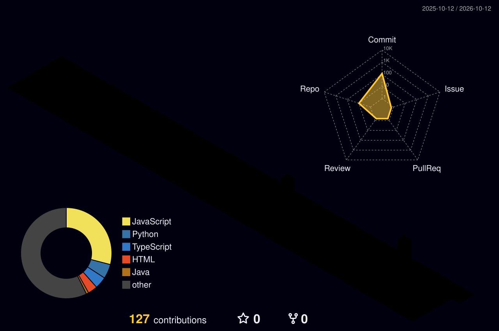

  <picture>
    <source media="(max-width: 600px) and (prefers-color-scheme: light)" srcset="./assets/generated/galaxy-header-mobile-light.svg?v=20261009">
    <source media="(max-width: 600px)" srcset="./assets/generated/galaxy-header-mobile.svg?v=20261009">
    <source media="(prefers-color-scheme: light)" srcset="./assets/generated/galaxy-header-light.svg?v=20261009">
    
  </picture>

  

    
  

  

    
    
    
  

## Executive Profile & Engineering Focus

I am **Minh Khai**, a software engineer based in Vietnam. I build web applications and backend systems, and explore embedded software and hardware. I value clean code, reliable solutions, and learning by building.

---

## Technology Landscape

  <picture>
    <source media="(max-width: 600px) and (prefers-color-scheme: light)" srcset="./assets/generated/tech-stack-mobile-light.svg">
    <source media="(max-width: 600px)" srcset="./assets/generated/tech-stack-mobile.svg">
    <source media="(prefers-color-scheme: light)" srcset="./assets/generated/tech-stack-light.svg">
    
  </picture>

   
  

---

## GitHub Activity

  <picture>
    <source media="(max-width: 600px) and (prefers-color-scheme: light)" srcset="./assets/generated/stats-card-mobile-light.svg">
    <source media="(max-width: 600px)" srcset="./assets/generated/stats-card-mobile.svg">
    <source media="(prefers-color-scheme: light)" srcset="./assets/generated/stats-card-light.svg">
    
  </picture>

 

  

---

  <h3>Build with purpose. Improve with evidence.</h3>
  
Interested in thoughtful software, autonomous systems, and ambitious engineering problems.

  

